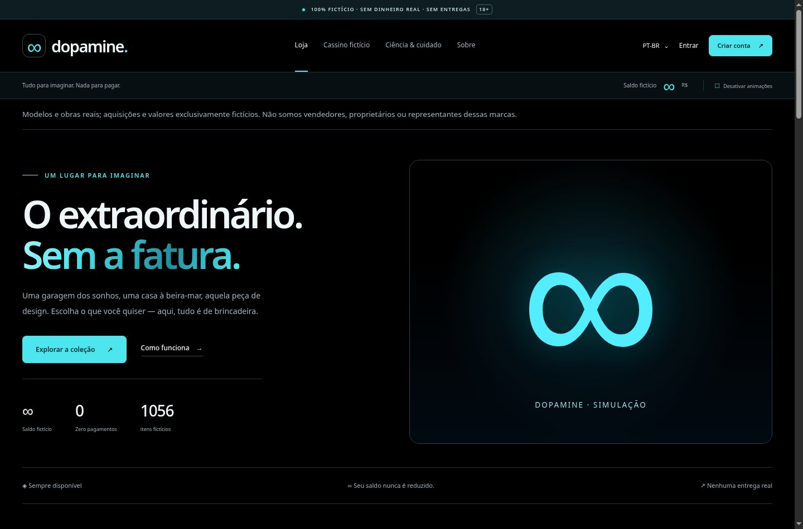

# Dopamine 1.2.1 — early11 compatibility bridge

[English](README.md) · [Português (Brasil)](README.pt-BR.md) · [Documentation / Documentação](docs/README.md)

Official running project: [dopamine.securityops.co](https://dopamine.securityops.co/). The hosted installation may run a different version; this repository update does not deploy the VPS.



Screenshots show the earlier 1.2.0 local demonstration captured on 6 September 2026. They are retained as a dated visual reference, not evidence of a 1.2.1 production deployment or imported production photo catalog.

## Quick local start

```sh
python3 -m venv .venv
.venv/bin/pip install -r requirements.txt
.venv/bin/python manage.py test
.venv/bin/python manage.py serve-local --port 3236
```

Open `http://127.0.0.1:3236/`. This loopback-only development command permits clearly marked missing photographs. It must not be used as a production bypass for catalog validation. Local data is written to `local-data/`, which is excluded from Git.

A fictional shopping collection and free casino simulator. Black/cyan theme, Portuguese (Brazil) by default, English, simplified Chinese and Japanese. Unlimited simulated balance, no real money, sales, payments, delivery or withdrawals.

## This release
The early11 bridge targets the first 1.1.0 implementation with the known schema 2 and 512 original catalog identities. It preserves core `user_version=2` and uses additive bridge tables. Unknown functional changes and other 1.1.0 variants are rejected. Read [the bridge guide](docs/BRIDGE-1.2.1.md) before any production update; do not use the incompatible original 1.2.0 updater.

Model-specific, non-reused photo import instead of generic category illustrations; 1,056 real-model/work candidates across 18 categories. The Docker build publishes 513–640 only after identity, license and uniqueness checks succeed. Candidates are NOT already verified products. No production photos are bundled. See docs/PHOTOS.md for the exact checks and limitations.

Seven interactive tables: European roulette; hit/stand/double blackjack; punto banco baccarat; three reels; two dice; Keno; Plinko. Random table outcomes can win, lose or push. A separately disclosed simulated refund and 100-unit grant preserve the unlimited-funds design without manipulating those results. Ten legacy scripted games remain clearly labeled in the Classic demonstrations section.

One small local MIT/Expat JavaScript file progressively enhances tables. No client framework/CDN or autoplay. Server forms still work without it; shop/authentication stay script-free. CSP is limited to same-origin script/connect only on table paths. Accessible controls and reduced motion are supported. GNU-style license labels are at /javascript; LibreJS was not executed as a browser extension in the authoring environment.

Amounts use R$/BRL, US$/USD, CN¥/CNY or JP¥/JPY according to language. Symbols/formatting change, not stored values or exchange rates. Names are real, prices and acquisitions fictional. Source credit and license links appear with published photos. Old fictional receipts preserve old names, not relabeled branded products.

## Existing production deployment
Use the separate `dopamine-update-1.2.1-early11.tar.gz` bundle's `apply.fish`, not the fresh-install deploy script. It preserves /opt/dopamine, the active .env/secret, named SQLite volume, npm-bridge and NPM upstream dopamine-web:8000. Only web is recreated. See docs/OPERATIONS.md for Fish upload/apply/preflight and rollback procedures.

```fish
fish apply.fish --target /opt/dopamine --npm npm-attachment --check
fish apply.fish --target /opt/dopamine --npm npm-attachment
```

A failed catalog build leaves the old app serving. A failure after switching attempts source/image rollback without restoring an older database snapshot. Migrations are additive. The exact recovery command is printed and kept with private backups.

## Development / verification
Install requirements in an isolated Python environment, then run `python manage.py test`. The Docker build repeats the suite, checks Gunicorn configuration, imports photographs and verifies the full publication before runtime. Production startup refuses a missing/incomplete real catalog. Testing configurations explicitly permit the unverified seed registry without images; do not use those settings for deployment.

`tests/browser_interactions.py` exercises actual HTML/CSS/JS through an offline WSGI bridge. This is not proof of real browser HTTP, CSP, cookie, TLS or NPM behavior. `tests/legacy_compatibility.py` accepts an untouched earlier source checkout and operates only on a disposable database.

Review docs/AUDIT.md for actual passed checks and unexecuted production work. No independent audit, current vulnerability scan or guarantee of zero bugs is claimed. Application source is MIT; photographs keep their separate per-file licenses.
