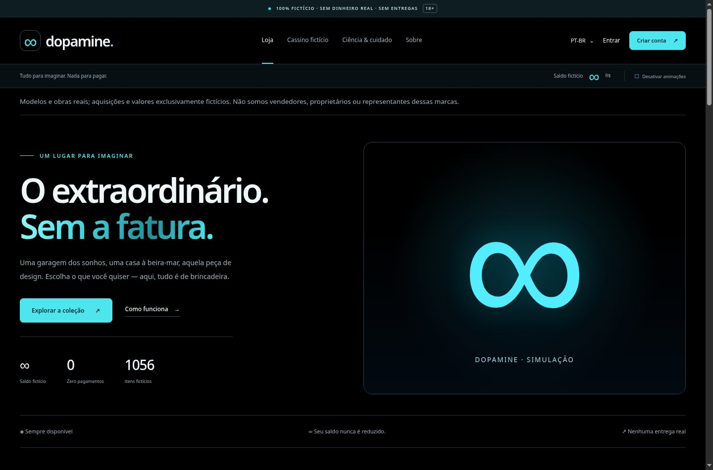

# Dopamine 1.2.0

[English](README.md) · [Português (Brasil)](README.pt-BR.md) · [Documentação](docs/README.md)

Coleção de compras fictícias e simulador gratuito de cassino, com tema preto/ciano, PT-BR por padrão e opções de inglês, chinês simplificado e japonês.

**Não há dinheiro real, vendas, pagamentos, entregas ou saques.** Preços e aquisições são fictícios, mesmo quando os nomes se referem a marcas/modelos reais. O saldo de demonstração não pode ser convertido em dinheiro.



Captura feita no Chromium em 6 de setembro de 2026, executando esta versão localmente. Fotografias ausentes são indicadas pela aplicação. Isso não comprova atualização da VPS nem importação do catálogo de produção.

## Executar localmente

```sh
python3 -m venv .venv
.venv/bin/pip install -r requirements.txt
.venv/bin/python manage.py test
.venv/bin/python manage.py serve-local --port 3236
```

Abra `http://127.0.0.1:3236/`. O comando é de desenvolvimento, limita o acesso a loopback e permite fotografias ausentes com aviso. Não use essa configuração para contornar a validação de produção. Os dados locais ficam em `local-data/`, fora do Git.

## O que a versão inclui

- Sete mesas interativas: roleta europeia, blackjack, baccarat, três rolos, dois dados, Keno e Plinko.
- Resultados podem ganhar, perder ou empatar. Um reembolso de demonstração e uma concessão separada de 100 unidades mantêm o saldo ilimitado; não alteram o resultado sorteado.
- Dez jogos legados continuam identificados como demonstrações clássicas.
- Moedas exibidas conforme o idioma: BRL, USD, CNY e JPY. Mudam símbolos/formatação, não valores armazenados ou taxas de câmbio.
- Formulários de servidor funcionam sem JavaScript. Um pequeno script local melhora as mesas; cadastro e loja permanecem sem dependência dele.

## Fotografias e produção

O registro contém 1.056 candidatos em 18 categorias, não 1.056 produtos já validados. Fotografias de produção não estão incluídas. O build só publica de 400 a 640 itens após verificar identidade, licença e unicidade. Falhas não devem ser escondidas reduzindo esse limite ou inventando licenças.

Uma instalação existente requer o pacote de atualização e seus procedimentos, não a execução cega do instalador inicial. Preserve `.env`, segredo, banco SQLite, volumes, rede e destino NPM. A versão antiga deve continuar servindo se o build do catálogo falhar.

## Documentação

- [Guia PT-BR: uso, arquitetura, fotos, segurança e operação](docs/GUIA.pt-BR.md)
- [Referências técnicas em inglês](docs/README.md)
- [Licença MIT](LICENSE), [avisos](NOTICE) e [segurança](SECURITY.md)

Não é um serviço de apostas reais nem uma promessa de benefício financeiro ou psicológico. Testes automatizados não substituem revisão de licenças das imagens, validação de produção ou auditoria independente.
