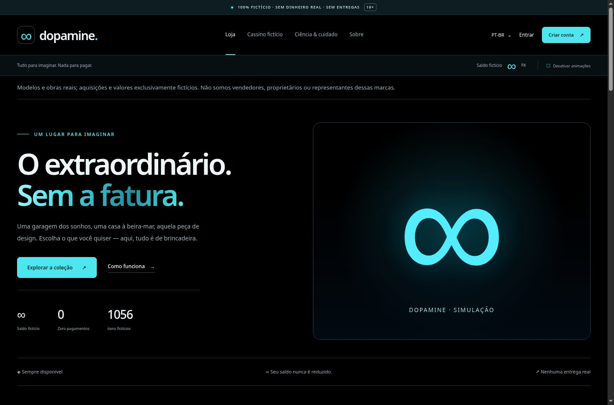
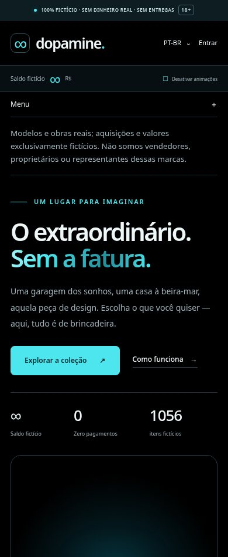

# Dopamine documentation / Documentação

[English overview](../README.md) · [Apresentação em português](../README.pt-BR.md)

Official running project / Projeto oficial: [dopamine.securityops.co](https://dopamine.securityops.co/).

Current source: **1.2.1, early11-schema2-v1**. Read the [compatibility bridge guide](BRIDGE-1.2.1.md) before updating the first 1.1.0 installation. The hosted version is independent of this source publication.

## Português (Brasil)

[Guia de uso e operação](GUIA.pt-BR.md): instalação local, funcionamento, saldos fictícios, catálogo, segurança, atualização, backup e recuperação.

## English references

- [Operations and rollback](OPERATIONS.md)
- [Photograph identity and licenses](PHOTOS.md)
- [Validation](VALIDATION.md)
- [Audit record and limitations](AUDIT.md)
- [Scientific context and limitations](SCIENCE.md)
- [Security policy](../SECURITY.md)

## Screenshots / Capturas

Local development mode of 1.2.0. Missing production photographs remain labeled; these images do not establish production readiness.

Modo de desenvolvimento local da versão 1.2.0. Fotografias ausentes continuam identificadas; as imagens não comprovam prontidão para produção.

Generation prompts are excluded from the published source. Licensing and technical references are retained.
